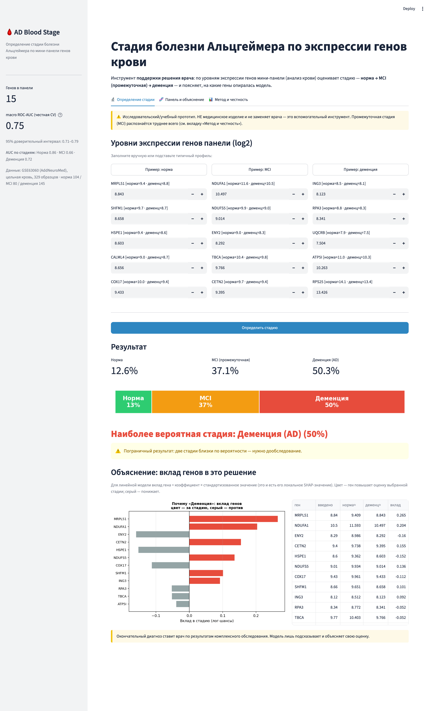
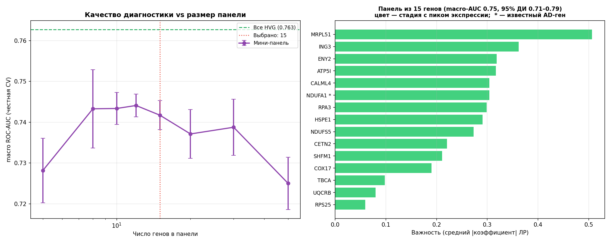
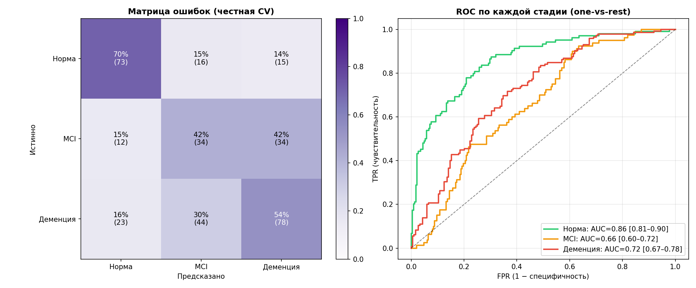
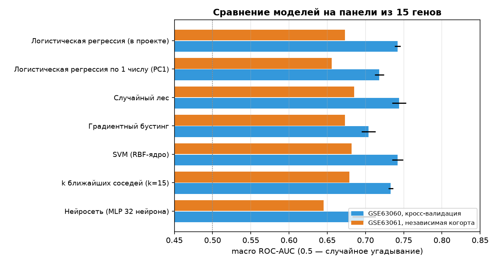

# AD Blood Stage — стадийная диагностика болезни Альцгеймера по экспрессии генов крови

Исследовательский проект по биоинформатике. Веб-прототип, который по уровням экспрессии небольшой панели генов в крови оценивает вероятность трёх состояний — **норма → MCI (умеренные когнитивные нарушения) → деменция при болезни Альцгеймера** — и объясняет, на какие гены опиралась модель.

**Веб-приложение:** https://alzheimer.5-144-180-9.sslip.io/altchgamer/

> **Коротко о результате.** Отбор без предварительной гипотезы из 17 654 генов выделил панель из 15 генов — преимущественно митохондриальных и рибосомальных. На кросс-валидации без утечки данных macro ROC-AUC = 0.74–0.75, на независимой когорте с другим чипом — 0.67. Сигнал воспроизводится: норма хорошо отделяется от нарушений, MCI и деменция различаются слабо. Это исследовательский прототип, а не медицинское изделие.

---

## 1. Проблема

Болезнь Альцгеймера (БА) — самая частая причина деменции. Патологические изменения (амилоидные бляшки, тау-клубки) начинаются за 10–20 лет до симптомов [1]. Одобренные препараты (леканемаб, донанемаб) замедляют снижение когнитивных функций на 27–35%, но только на ранних стадиях — при MCI и лёгкой деменции [2, 3]. Подтверждение диагноза требует ПЭТ или люмбальной пункции: это дорого или инвазивно. Поэтому нужен доступный первичный фильтр — например, анализ крови.

**Цель:** разработать интерпретируемую модель, которая по небольшой панели генов крови разделяет норму, MCI и деменцию, проверить её на независимых данных и сделать веб-прототип.

---

## 2. Почему кровь и почему эти гены

**Связь крови и мозга.** При когнитивных нарушениях рано повреждается гематоэнцефалический барьер (ГЭБ), в том числе перициты — клетки стенки капилляров [4]. Периферическое воспаление и иммунные клетки крови взаимодействуют с мозгом через повреждённый барьер [5]. Поэтому состояние клеток крови частично отражает процессы в мозге.

**Энергетический обмен.** На данных той же когорты AddNeuroMed показано, что в крови при MCI и БА снижена экспрессия генов окислительного фосфорилирования (дыхательной цепи митохондрий) и синтеза белка [6, 7]. Наш отбор генов шёл по всем генам без предварительной гипотезы — и выделил именно такие гены. Это согласуется с литературой, но не является независимым подтверждением: данные из той же когорты.

**Почему 15 генов.** Маленькую панель дешевле измерять и проще перенести на другой метод (например, qPCR — после отдельной калибровки). Качество выходит на плато уже при 8 генах (раздел 7), 15 — запас устойчивости.

---

## 3. Сравнение с другими работами

| Работа | Данные | Задача | Результат | Интерпретация | Приложение |
|---|---|---|---|---|---|
| **AD Blood Stage (наш)** | гены крови, GSE63060 → проверка на GSE63061 | 3 класса | CV 0.74; внешняя 0.67 | SHAP глобально и для каждого пациента | да |
| Li и соавт., 2018 [8] | гены крови, GSE63060 + GSE63061 | AD против нормы | панель NDUFA1, MRPL51, RPL36AL; AUC ≈ 0.86 | — | нет |
| Sarma, Chatterjee, 2025 [9] | гены крови, GSE63060, GSE63061, ADNI | 3 класса | AUC 0.82 / 0.74 / 0.79 (норма / MCI / AD) | — | нет |
| Lunnon и соавт., 2012 [6] | гены крови, AddNeuroMed | анализ различий | снижение митохондриальных генов при MCI и AD | — | нет |

**Что нового в нашей работе.** Мы не превосходим опубликованные модели по точности и не претендуем на это. Наш независимый отбор нашёл те же гены, что и Li и соавт. (NDUFA1, MRPL51), — это подтверждает, что сигнал устойчив. Вклад проекта:

- три стадии с метриками и доверительными интервалами **для каждой стадии**, а не только средними;
- отбор генов строго внутри кросс-валидации (без утечки) и контроль величины утечки;
- проверка на независимой когорте с другим чипом и демонстрация того, что без пересчёта шкалы модель ломается;
- сравнение семи моделей при одинаковой процедуре проверки;
- веб-прототип с объяснением каждого предсказания и примерами реальных пациентов, которых модель не видела.

---

## 4. Функционал

- **Вход:** уровни экспрессии 15 генов панели **в шкале микрочипа Illumina HumanHT-12** (нормализованные log2-значения, как в GSE63060). Результаты qPCR или другого чипа без калибровки модель интерпретирует неверно (раздел 7.3).
- **Выход:** вероятности трёх стадий, наиболее вероятная стадия, вклад каждого гена в решение (локальные SHAP-значения).
- **Примеры:** средние профили групп и кнопка «случайный реальный пациент» — человек из независимой когорты GSE63061 с настоящим диагнозом, который показывается после предсказания.
- **Назначение:** демонстрация исследовательского результата и обучение; не диагноз.

---

## 5. Данные и предобработка

| | GSE63060 (обучение) | GSE63061 (внешняя проверка) |
|---|---|---|
| Когорта | AddNeuroMed, партия 1 | AddNeuroMed, партия 2 (другие люди) |
| Материал | цельная кровь | цельная кровь |
| Чип | Illumina HumanHT-12 v3 (GPL6947) | Illumina HumanHT-12 v4 (GPL10558) |
| Норма / MCI / деменция | 104 / 80 / 145 | 134 / 109 / 139 |

Данные открытые, из NCBI GEO. Авторы датасетов уже нормализовали данные и перевели их в log2-шкалу (значения ≈ 7–15). В GSE63061 исключены 6 образцов с пограничными или сменившимися диагнозами.

**Шаги и их обоснование:**

1. **Зонды → гены.** В матрице 38 323 зонда; с аннотацией гена — 25 074. Если у гена несколько зондов, берётся зонд с наибольшей дисперсией (он сильнее всего меняется между людьми, то есть реально что-то измеряет). Итог: 17 654 гена. Диагнозы при этом не используются.
2. **Проверка шкалы.** `preprocessor.py` проверяет, что данные уже в log2 (максимум 15.05), и повторно не логарифмирует. Пропуски заполняются средним, гены с нулевой дисперсией удаляются.
3. **Предфильтр 3000 вариабельных генов (HVG).** Отбрасывает гены с почти постоянным уровнем сигнала — они не могут различать группы. Диагнозы не используются, поэтому это не утечка. Предфильтр считается по всем образцам до кросс-валидации; на результат это практически не влияет.
4. **Отбор 15 генов по ANOVA F-критерию** — заново внутри каждого из 25 фолдов (5 фолдов × 5 повторов), только по обучающей части. ANOVA выбрана потому, что групп три (для двух групп она совпадает с t-критерием: F = t²).
5. **Стандартизация (StandardScaler)** — внутри каждого фолда по обучающей части. Нужна, чтобы гены с разным уровнем и разбросом сигнала были сопоставимы для модели и регуляризации.

---

## 6. Модель и проверка

- **Мультиномиальная логистическая регрессия** (`class_weight="balanced"`, `C=1.0`, `max_iter=3000`). Для каждой стадии считается взвешенная сумма генов, функция softmax превращает три суммы в вероятности. `class_weight="balanced"` увеличивает вес ошибок на малых классах, иначе модель почти не предсказывала бы MCI (80 человек против 145 с деменцией). `C=1.0` — стандартная сила L2-регуляризации, не подбиралась.
- **Почему логистическая регрессия.** Мало образцов (329) — сложные модели легко переобучаются; сигнал по сути линейный (гены снижены при болезни); вклад каждого гена считается точно; модель выдаёт вероятности. Сравнение с шестью другими моделями — в разделе 7.4.
- **Повторная стратифицированная кросс-валидация 5×5.** Каждый человек получает предсказание от модели, которая его не видела (out-of-fold). Пять повторов с разным разбиением уменьшают зависимость от одного удачного разбиения.
- **Контроль утечки.** Для сравнения считается и «наивный» вариант с отбором генов по всем данным до кросс-валидации.
- **Бутстрэп 95% ДИ** (2000 повторов) по out-of-fold предсказаниям — показывает неопределённость метрик при небольшой выборке [10].
- **Внешняя проверка.** Модель обучается на всём GSE63060 и применяется к GSE63061. Шкалы чипов v3 и v4 различаются, поэтому каждый датасет стандартизуется отдельно.

---

## 7. Результаты

### 7.1. Кросс-валидация на GSE63060

| Метрика | Значение (95% ДИ) |
|---|---|
| macro ROC-AUC | 0.742 — среднее по 5 повторам; 0.748 (0.71–0.79) — последний повтор |
| AUC норма | 0.86 (0.81–0.90) |
| AUC MCI | 0.66 (0.60–0.72) |
| AUC деменция | 0.72 (0.67–0.78) |
| macro-F1 / balanced accuracy | 0.54 / 0.55 (случайное угадывание — 0.33) |

ДИ, AUC по стадиям и матрица ошибок посчитаны по последнему повтору кросс-валидации.

**Контроль утечки.** «Наивный» отбор даёт 0.742 — столько же. Значит, в этих данных утечка при отборе генов почти не завышает оценку: сигнал сильный, и в топ всегда попадают одни и те же гены. Это **не доказывает** отсутствие переобучения — обобщаемость на новых людях проверяется только на независимой когорте (7.2).

**Размер панели.** 5 генов — 0.728, 8 — 0.743, 15 — 0.742, 50 — 0.725, все 3000 HVG — 0.763.

### 7.2. Независимая когорта GSE63061

| Метрика | GSE63060, кросс-валидация | GSE63061, внешняя проверка |
|---|---|---|
| macro ROC-AUC | 0.74 | **0.67** (0.63–0.72) |
| AUC норма / MCI / деменция | 0.86 / 0.66 / 0.72 | 0.70 / 0.61 / 0.70 |
| норма против нарушения | — | 0.70 |
| MCI против деменции | — | 0.67 |
| balanced accuracy | 0.55 | 0.48 |

Сигнал воспроизводится на других людях и другом чипе: модель работает лучше случайного угадывания, а гены панели снижены при MCI и деменции так же, как в GSE63060. Качество ниже, чем на кросс-валидации, — так и бывает при переходе на новые данные.

### 7.3. Без пересчёта шкалы модель ломается

Если подать значения чипа v4 в шкале v3 без пересчёта, модель почти всем ставит «MCI» (balanced accuracy 0.35). Вывод для практики: перед применением в другой лаборатории модель нужно калибровать под её платформу.

### 7.4. Сравнение моделей

Одинаковая процедура для всех моделей: те же 15 генов, отбор внутри фолдов, та же внешняя когорта (`python cli.py compare`).

| Модель | CV macro-AUC | GSE63061 macro-AUC |
|---|---|---|
| **Логистическая регрессия (в проекте)** | 0.742 | 0.673 |
| Логистическая регрессия по одному числу (1-я главная компонента) | 0.718 | 0.656 |
| Случайный лес | 0.744 | 0.685 |
| Градиентный бустинг | 0.704 | 0.673 |
| SVM (RBF-ядро) | 0.742 | 0.682 |
| k ближайших соседей | 0.733 | 0.679 |
| Нейросеть (MLP, 32 нейрона) | 0.698 | 0.645 |

Сложные модели не дают заметного выигрыша: все результаты находятся в пределах доверительного интервала (0.63–0.72 на внешней когорте). Нейросеть и бустинг на 329 образцах даже хуже. Логистическая регрессия выбрана за простоту, устойчивость и точную интерпретацию.

### 7.5. Биология панели

MRPL51, NDUFA1, ING3, SHFM1, NDUFS5, RPA3, HSPE1, ENY2, UQCRB, CALML4, TBCA, ATP5I, COX17, CETN2, RPS25. Большинство генов связаны с дыхательной цепью митохондрий (NDUFA1, NDUFS5 — комплекс I; UQCRB — комплекс III; COX17 — комплекс IV; ATP5I — АТФ-синтаза), синтезом белка в митохондриях и цитоплазме (MRPL51, RPS25) и сворачиванием белков (HSPE1).

- У **всех 15** генов экспрессия при MCI и деменции ниже, чем в норме.
- Строго «норма > MCI > деменция» — только у **8 из 15**; у остальных MCI и деменция почти равны. Сигнал крови «включается» уже на стадии MCI и потом почти не растёт.
- Гены сильно связаны между собой: **медианная корреляция 0.85**, первая главная компонента объясняет **84%** разброса. По сути, панель измеряет один общий показатель — «насколько снижен энергетический обмен в клетках крови». Модель по одному этому числу почти не уступает 15 генам (0.72 против 0.74).

Отсюда два следствия: (1) MCI и деменция плохо различаются, потому что один показатель хорошо отделяет «норму» от «не нормы», но плохо различает две стадии нарушения; (2) коэффициенты и SHAP-вклады отдельных генов нужно читать как вклад всей группы похожих генов — у сильно связанных признаков модель распределяет вес между ними неоднозначно.

---

## 8. Функциональная схема

    GSE63060 + GSE63061 (кровь, микрочипы Illumina v3 / v4)
       │  download_data.py — series matrix + аннотации GPL6947 / GPL10558
       ▼
    data_loader.py — зонды → гены, метки стадий CTL / MCI / AD
       │  preprocessor.py — проверка log2-шкалы, пропуски, константные гены
       ▼
    biomarker_panel.py — предфильтр 3000 HVG → ANOVA-отбор 15 генов внутри фолдов
       │  логистическая регрессия, CV 5×5 без утечки, бутстрэп 95% ДИ, SHAP
       ▼
    results/panel_model.pkl ──► external_validation.py — проверка на GSE63061
       │                        compare_models.py   — сравнение 7 моделей
       ▼
    app.py (Streamlit) — ввод 15 генов → 3 вероятности + вклад генов
                         + реальные пациенты GSE63061 + ограничения

---

## 9. Запуск

    python3 -m venv venv && source venv/bin/activate
    pip install -r requirements.txt

    python cli.py download    # GSE63060 и GSE63061 с NCBI GEO (~150 МБ)
    python cli.py panel       # отбор панели + обучение модели
    python cli.py external    # проверка на независимой когорте GSE63061
    python cli.py compare     # сравнение с другими моделями
    streamlit run app.py      # веб-интерфейс, http://localhost:8501

Streamlit выбран, потому что позволяет сделать интерактивный интерфейс на Python без отдельной frontend-разработки — это удобно для исследовательских прототипов.

---

## 10. Структура проекта

    alzheimer/
    ├── cli.py                  — точка входа: download / panel / external / compare
    ├── config.py               — параметры: датасеты, классы, размер панели, CV
    ├── download_data.py        — загрузка GSE63060, GSE63061 и аннотаций платформ
    ├── data_loader.py          — разбор series matrix, зонды → гены, метки стадий
    ├── preprocessor.py         — проверка шкалы и очистка
    ├── biomarker_panel.py      — отбор панели, модель, CV без утечки, ДИ, SHAP, графики
    ├── external_validation.py  — проверка на независимой когорте GSE63061
    ├── compare_models.py       — сравнение 7 моделей при одинаковой проверке
    ├── app.py                  — веб-интерфейс Streamlit
    ├── results/                — модель, таблицы и графики (закоммичены для развёртывания)
    └── docs/img/               — изображения для README

---

## 11. Ограничения

- **Одна когорта.** Обе партии — проект AddNeuroMed, европейская популяция. Нужна проверка в других популяциях и на других платформах.
- **Клинические диагнозы.** Диагнозы поставлены по клиническим критериям, без биомаркеров амилоида и тау. MCI — синдром, а не подтверждённая стадия БА; часть людей с MCI никогда не заболеет деменцией. Слово «стадия» используется в широком смысле.
- **MCI распознаётся хуже всего** (AUC 0.66 на кросс-валидации, 0.61 на внешней когорте). Реалистичный сценарий — скрининг: «кровь отклоняется от нормы → направление на углублённое обследование».
- **Возможные искажающие факторы:** возраст, пол, состав клеток крови (при MCI и AD описано больше базофилов и моноцитов [6]), лекарства, сопутствующие болезни.
- **Платформа.** Модель понимает только шкалу чипа Illumina HumanHT-12 после той же нормализации.
- **Гиперпараметры не подбирались** (используются стандартные значения), поэтому оценка не завышена подбором, но и не оптимальна.
- **Статус.** Исследовательский прототип, не медицинское изделие. Данные обезличены.

---

## Литература

1. Jack C. R. Jr. et al. NIA-AA Research Framework: Toward a biological definition of Alzheimer's disease // Alzheimer's & Dementia. 2018. Vol. 14, № 4. P. 535–562. https://doi.org/10.1016/j.jalz.2018.02.018
2. van Dyck C. H. et al. Lecanemab in Early Alzheimer's Disease // New England Journal of Medicine. 2023. Vol. 388. P. 9–21. https://doi.org/10.1056/NEJMoa2212948
3. Sims J. R. et al. Donanemab in Early Symptomatic Alzheimer Disease: The TRAILBLAZER-ALZ 2 Randomized Clinical Trial // JAMA. 2023. Vol. 330, № 6. P. 512–527. https://doi.org/10.1001/jama.2023.13239
4. Nation D. A., Sweeney M. D., Montagne A. et al. Blood–brain barrier breakdown is an early biomarker of human cognitive dysfunction // Nature Medicine. 2019. Vol. 25. P. 270–276. https://doi.org/10.1038/s41591-018-0297-y
5. Beltran-Velasco A. I., Clemente-Suárez V. J. Impact of Peripheral Inflammation on Blood–Brain Barrier Dysfunction and Its Role in Neurodegenerative Diseases // International Journal of Molecular Sciences. 2025. Vol. 26. https://pmc.ncbi.nlm.nih.gov/articles/PMC11942216/
6. Lunnon K., Ibrahim Z., Proitsi P. et al. Mitochondrial dysfunction and immune activation are detectable in early Alzheimer's disease blood // Journal of Alzheimer's Disease. 2012. https://pubmed.ncbi.nlm.nih.gov/22466004/
7. Lunnon K., Keohane A., Pidsley R. et al. Mitochondrial genes are altered in blood early in Alzheimer's disease // Neurobiology of Aging. 2017. https://pubmed.ncbi.nlm.nih.gov/28208064/
8. Li X., Wang H., Long J. et al. Systematic Analysis and Biomarker Study for Alzheimer's Disease // Scientific Reports. 2018. Vol. 8. Art. 17394. https://doi.org/10.1038/s41598-018-35789-3
9. Sarma M., Chatterjee S. 'Machine Learning' multiclassification for stage diagnosis of Alzheimer's disease utilizing augmented blood gene expression and feature fusion // Discover Applied Sciences. 2025. Vol. 7. Art. 636. https://d-nb.info/137407621X/34
10. Varoquaux G. Cross-validation failure: small sample sizes lead to large error bars // NeuroImage. 2018. Vol. 180. P. 68–77. https://doi.org/10.1016/j.neuroimage.2017.06.061
11. Данные: GSE63060 и GSE63061, NCBI Gene Expression Omnibus. https://www.ncbi.nlm.nih.gov/geo/query/acc.cgi?acc=GSE63060 , https://www.ncbi.nlm.nih.gov/geo/query/acc.cgi?acc=GSE63061
